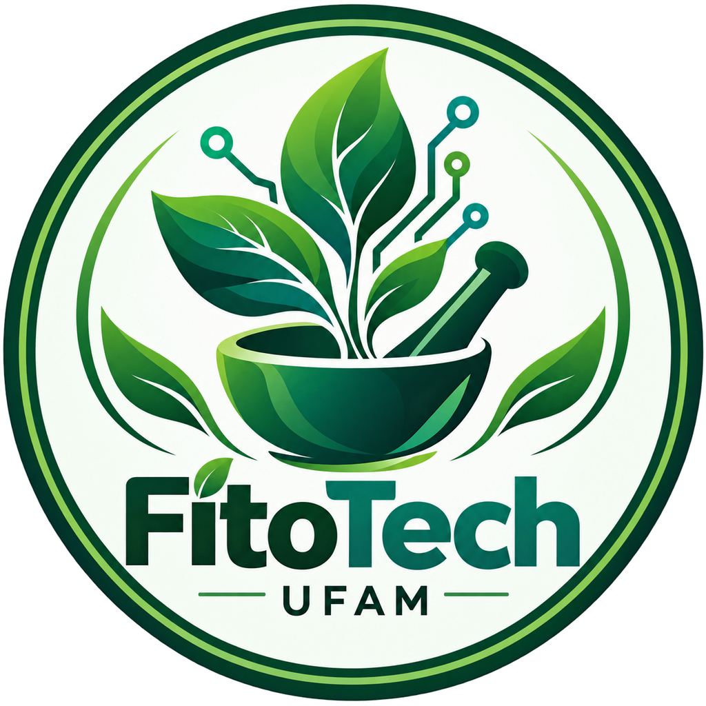

# FitoTech - UFAM — Cartilha Digital de Fitoterapia

<p align="center"></p>

Protótipo de aplicativo para profissionais de saúde com as **28 espécies do Memento Fitoterápico da Farmacopeia Brasileira (Anvisa, 2016)**. É um site instalável (PWA) publicado no GitHub Pages, com versões para **Android (APK)**, **Windows (.exe)** e **iPhone** (atalho na tela inicial). Todas as versões abrem o mesmo site online, então uma atualização no site chega a todos os apps.

## Acesso

- **Site:** https://ig0rscruz.github.io/fitotech-ufam/
- **Android (APK) e Windows (.exe):** página **Apps** dentro do site (os instaladores ficam em `downloads/` no próprio site)
- **iPhone:** abrir o site no Safari → Compartilhar → Adicionar à Tela de Início

## Perfis de uso: paciente × profissional

Na primeira abertura o app pergunta **quem está usando**:

- **Paciente / cidadão:** vê para que serve cada planta, contraindicações, interações, efeitos adversos, identificação, cuidados e emergência. **Não** vê doses, preparo, formulações magistrais, calculadora, atendimento nem receituário — evita automedicação e manipulação caseira inadequada.
- **Profissional de saúde:** precisa marcar uma declaração; tem acesso completo.

O perfil pode ser trocado pelo selo no topo ou em **Mais → Trocar perfil**.

## O que o app tem

| Exigência da atividade | Onde está no app |
|---|---|
| Fotos das espécies | Ficha de cada espécie (galeria) e **Identificar** |
| Nome científico e nomes populares | Ficha → topo |
| Parte utilizada | Ficha → "Parte utilizada" + mapa ✔/✖ sobre a foto |
| Indicações terapêuticas | Ficha → "Faz bem / indicado para" e seção do Memento |
| Formas farmacêuticas, preparo e posologia | Ficha → "Modo de preparo e formulação" (população × manipulação) |
| Contraindicações e precauções | Ficha → "Pode fazer mal", "Atenção" e seções do Memento |
| Interações medicamentosas | Ficha → seção própria + selos 💊 |
| Via de administração e tempo máximo | Ficha → topo |
| **Diferencial:** glossário (infusão × decocção × maceração × tintura) | **Glossário** (tabela comparativa + 36 termos) |
| **Diferencial:** busca inteligente | Busca por nome popular, científico, sintoma ("ansiedade", "tosse", "dispepsia") ou característica ("flor amarela", "raiz") |
| **Diferencial:** alertas de risco | Selos 🤰 gestação, 🩸 sangramento, 💊 interações graves, idade mínima, fígado, sol |
| **Diferencial:** calculadora de posologia | **Calculadora**: planta seca/fresca por volume, colheres, tinturas em gotas, dose total — e **avaliação de risco da dose**: abaixo/dentro/acima da faixa do Memento, doses por dia acima do máximo, duração acima do tempo máximo, sintomas de superdosagem, contraindicações da espécie e situação do paciente em atendimento |
| Extras da equipe | **Atendimento** (PA, FC, peso, altura → IMC, glicemia, temperatura, SpO₂, comorbidades, medicamentos) com triagem automática ✔ / ⚠ / ⛔ e **receituário** para imprimir; **Emergência** (SAMU 192, Disque-Intoxicação 0800 722 6001, CIATox personalizável); **Identificador visual** com comparação de foto e link para IA (Pl@ntNet); modo escuro; funciona offline |

## Estrutura

```
app/        ← o site (é isto que vai para o GitHub Pages)
  js/data.js   ← banco de dados das 28 espécies (editável)
  js/app.js    ← lógica do app
desktop/    ← app Windows (Electron)
mobile/     ← app Android (Capacitor)
.github/workflows/  ← publicação automática (site + APK + .exe)
```

## Publicar (uma vez só)

1. Crie um repositório **público** no GitHub (ex.: `fitotech`).
2. Na pasta do projeto, envie os arquivos:
   ```bash
   git init -b main
   git add .
   git commit -m "FitoTech"
   git remote add origin https://github.com/SEU-USUARIO/fitotech.git
   git push -u origin main
   ```
3. No GitHub: **Settings → Pages → Build and deployment → Source: GitHub Actions**. Depois, em **Actions**, rode de novo "Publicar site" se ele tiver falhado antes desse ajuste.
4. Pronto:
   - Site: `https://SEU-USUARIO.github.io/fitotech/`
   - APK e instalador Windows: publicados junto com o site em `downloads/` pelo workflow "Publicar site e apps". Não usamos GitHub Releases, porque eles sempre anexam o código-fonte.

Os PDFs ficam fora do repositório (`.gitignore`).

## Instalar

- **Android:** baixar `FitoTech.apk` na página Apps do site (permitir "fontes desconhecidas"), ou no Chrome → "Instalar app".
- **Windows:** baixar `FitoTech-Setup.exe` na página Apps do site, ou no Edge/Chrome → ícone "Instalar".
- **iPhone/iPad:** abrir o site no **Safari → Compartilhar → Adicionar à Tela de Início**. (Um app na App Store exigiria Mac e conta Apple Developer paga.)

A página **Apps** dentro do próprio site mostra esses links automaticamente.

## Testar no computador

```bash
python -m http.server 5173 --directory app
```
Abra `http://localhost:5173`.

## Editar o conteúdo

Tudo das espécies está em `app/js/data.js`:
- `memento`: texto da monografia oficial (extraído do PDF do Memento).
- `riscos`: alertas usados no atendimento (`"c"` = contraindicado, `"a"` = atenção).
- `tags`: sintomas usados na busca. `calc`: parâmetros da calculadora. `populacao` / `magistral`: preparo.
- `fotos`: troque ou acrescente imagens em `app/assets/img/`.

### Imagens

- **Capas ilustradas:** `app/assets/img/capas/<id-da-especie>.jpg` (ex.: `glycine-max.jpg`). Na ficha, a ilustração aparece na frente e a foto real desfocada ao fundo; as fotos reais ficam na galeria.
- As 28 espécies têm capa. Para trocar uma, salve o arquivo com o id da espécie (JPG 1080 × 1080) na pasta `capas`.
- A pasta `Imagens Renderizadas/` (originais de ~2 MB cada) não vai para o GitHub; as versões otimizadas já estão no app.

> A foto real do **alecrim-pimenta** é de outra espécie do mesmo gênero (*Lippia graveolens*), porque não há foto livre de *L. sidoides* na Wikimedia. Substitua por uma foto da equipe.

## Roteiro sugerido para a apresentação (10 min)

1. **(1 min) Problema:** falta de acesso rápido a posologia, contraindicações e interações na hora da prescrição.
2. **(1 min) Tour:** escolha de perfil (paciente × profissional — mostrar que o paciente não vê doses nem a calculadora) → início → busca → selos de alerta → instalação no celular (mostrar o app instalado).
3. **(5 min) Caso clínico ao vivo** — em **Atendimento**, carregar "Climatério + hipertensão":
   - PA 150/95 é classificada como HAS estágio 1 e marcada sozinha como comorbidade.
   - Queixa "fogacho" → soja e trevo-vermelho compatíveis; cimicifuga com ⚠ (anti-hipertensivo).
   - Abrir a ficha da soja, mostrar preparo, interações (levotiroxina, tamoxifeno) e prescrever → imprimir receituário.
   - Trocar para o caso "HIV em TARV + resfriado": equinácea e alho ⛔ — o app impede um erro grave.
4. **(1 min) Calculadora:** espinheira-santa, 3 g/150 mL, 3×/dia → total e preparo; depois subir para 6 g e 5×/dia e mostrar o alerta de superdosagem.
5. **(1 min) Glossário, Identificador visual e Emergência** (ligar 0800 722 6001 direto do app).
6. **(1 min) Fontes e limites:** Memento (Anvisa, 2016); ferramenta de apoio, não substitui avaliação clínica.

## Fontes

- BRASIL. Anvisa. *Memento Fitoterápico da Farmacopeia Brasileira*. 1. ed. Brasília, 2016.
- Fotos: Wikimedia Commons (link de cada foto na ficha) e anotações da equipe.
- Classificação da PA: Diretrizes Brasileiras de Hipertensão Arterial (SBC, 2020). IMC: OMS; idosos: Lipschitz (1994).

Ferramenta educacional e de apoio à decisão. Não substitui o julgamento clínico nem a monografia oficial.
